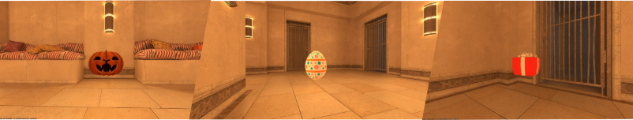

# HuntDownTheEggs_Models
Custom ported prop models for plugin HuntDownTheEggs with animations. These models work fine with trigger settings since they have their own meshes and hitboxes.

## Credits
- [Easter egg - dimension Dazzle](https://www.fab.com/listings/bb79f4a4-1a25-4dc4-81a6-f06e4014b522)
- [Stylized Halloween Pumpkin - Enkarra3D](https://www.fab.com/listings/aef54330-2dc7-460a-81c6-e96c0f9b6898)
- [Gift - Gorzi](https://www.fab.com/listings/52e3cc14-0263-478f-be5d-2ef733a058d1)

## HuntDownTheEggs:
- [HuntDownTheEggs CounterStrikeSharp](https://github.com/Letaryat/HuntDownTheEggs/)
- [HuntDownTheEggs Swiftly2](https://github.com/letiPoorPlugins/HuntDownTheEggs_SW/)

## Animations:
- `huntdowntheeggs_rotateAction` - Loop animation of rotating prop
- `huntdowntheEggs_collect` - Collect animation of prop

## Showcase

    

